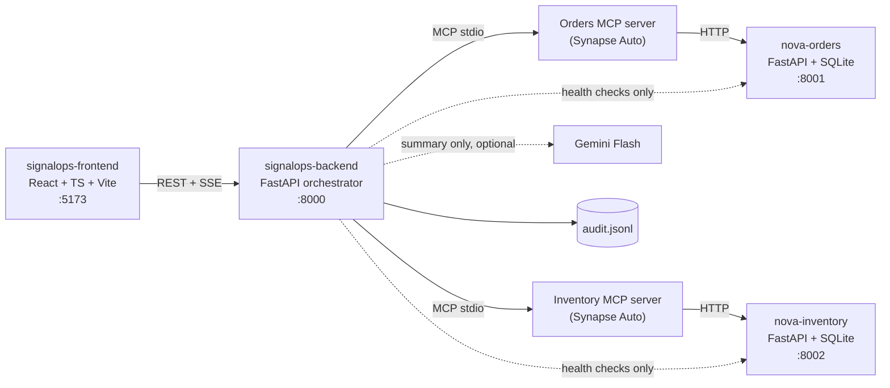

# SignalOps — AI Business Incident Investigator

**2nd Brain Labs × Geek Room Vibe-a-thon · Track 3: A Copilot Across Two Systems**

SignalOps connects two separate business systems through **Synapse-generated MCP servers**, investigates an operational incident across both, proves the likely root cause with source evidence, quantifies the impact in code, and recommends actions that run only after human approval.

> *Orders know about customers. Inventory knows about stock. Support knows who's unhappy. SignalOps connects the dots.*

## The problem
An inventory sync failure at one warehouse quietly blocks orders. The orders system only sees "allocation failed"; the inventory system only sees a failed sync; support sees angry customers. Nobody sees the incident until someone cross-checks dashboards by hand.

## What SignalOps does (demo scenario: NovaCommerce)
1. **Investigates across both systems via MCP** — 30 tool calls on two Synapse MCP servers in ~3–4 s.
2. **Correlates** 30 delayed orders: 28 are linked to the W1-WMS sync failure for SKU-104 (same SKU, same warehouse, dispatch due after the failure began); 2 are unrelated carrier exceptions.
3. **Proves it with evidence** — every finding cites evidence items with source system, MCP tool, endpoint and entity IDs. The root cause is reported as **likely**, not "confirmed": each fact is confirmed at source, but causality is inferred and W1's physical stock is unknown (stale).
4. **Computes impact deterministically** — 24 customers, $7,224.00, 12 orders past dispatch date + 16 at risk, 4 VIPs, 9 open complaints (overlaps never added).
5. **Ranks customers with transparent rules** and plans a W2→W1 transfer that keeps safety stock: **20 of 28 orders recoverable**.
6. **Requires approval** for every consequential action; execution is simulated, re-validated live via MCP, idempotent, and written to an append-only audit log.
7. **Grows with the systems** — add an endpoint, run `synapse build --discover`, and the agent uses the new tool on the next investigation without a restart.

## Why Synapse
The business APIs already exist. Synapse Auto turns them into MCP tools **without rewriting either system**, and the copilot reaches business data **only** through those tools (direct HTTP is used solely for health checks). Live discovery shows a newly added API capability becoming agent-accessible in seconds: *we didn't rewrite these business systems — we made them agent-ready.*

## Architecture

More: [docs/architecture.md](docs/architecture.md).

| Component | What it is |
|---|---|
| `nova-orders/` | Orders, customers, shipments, support tickets. Independent FastAPI app + own SQLite. |
| `nova-inventory/` | Products, warehouses, stock, sync status. Independent FastAPI app + own SQLite. |
| `signalops-backend/` | Controlled investigation workflow (no agent framework, bounded tool calls), deterministic correlation/impact/prioritization, approvals, audit, HTTP + SSE API. |
| `signalops-frontend/` | Overview, Investigations (live activity), Incident reports (printable), Approvals, Systems / MCP. |
| `docs/` | Plan, contracts, decisions, demo state, Synapse setup, live-endpoint script, demo script, judging checklist. |

## Setup (Windows; Python 3.14, Node 20+)
```powershell
# 1. Business APIs and backend (each has its own virtualenv)
foreach ($d in "nova-orders","nova-inventory","signalops-backend") {
  python -m venv "$d\.venv"; & "$d\.venv\Scripts\python" -m pip install -r "$d\requirements.txt" }
cd signalops-frontend; npm install; cd ..

# 2. Synapse
npm install -g @2ndbrainlabs-ai/synapse-cli @2ndbrainlabs-ai/synapse-mcp
synapse config set-key --global            # paste your Synapse key when prompted

# 3. Secrets
copy .env.example .env                     # fill SYNAPSE_API_KEY and GEMINI_API_KEY

# 4. Generate the MCP servers (APIs must be running) — exact commands: docs/synapse-setup.md
#    then set ORDERS_MCP_SERVER_ID / INVENTORY_MCP_SERVER_ID in .env to the printed server_ids

# 5. Run everything
powershell -File scripts\start-demo.ps1 -Reset   # reseeds, starts 4 windows, waits until all are up
# open http://localhost:5173
```

## Tests
```powershell
cd nova-orders;       .venv\Scripts\python -m pytest -q   # 12 API tests (seed counts, filters, errors)
cd nova-inventory;    .venv\Scripts\python -m pytest -q   # 9 API tests
cd signalops-backend; .venv\Scripts\python -m pytest -q   # 37: logic, orchestrator failure modes, approvals safety, API, live MCP
python scripts\rehearse.py 5                               # end-to-end against the running stack
```
`tests/test_mcp_tools.py` calls every MCP tool through Synapse and needs the stack running; the rest run offline.

## Demo
- Script: [docs/demo-script.md](docs/demo-script.md) · prompt and expected numbers: [docs/DEMO_STATE.md](docs/DEMO_STATE.md)
- Live discovery (paste-ready): [docs/live-endpoint.md](docs/live-endpoint.md) · backup screenshots: `docs/demo-backup/`
- Track 3 compliance with evidence: [docs/judging-checklist.md](docs/judging-checklist.md)

## Honest limitations
- Synapse v0.1.9 Auto exposes **path parameters only**, so list tools return full lists (limit 200) and the agent filters in code, checking `total == len(items)` and flagging truncation.
- The Gemini free tier is slow or overloaded at times. Gemini only writes the executive summary; if it fails, a clearly labelled template summary is shown. **No number or finding depends on the LLM.**
- Investigations and the simulated ledger are in memory (the audit log is on disk). All actions are simulated; customer notices are drafts and are never sent.
- All data is fictional and deterministic, with a fixed demo clock (`2026-11-24T12:00`).
