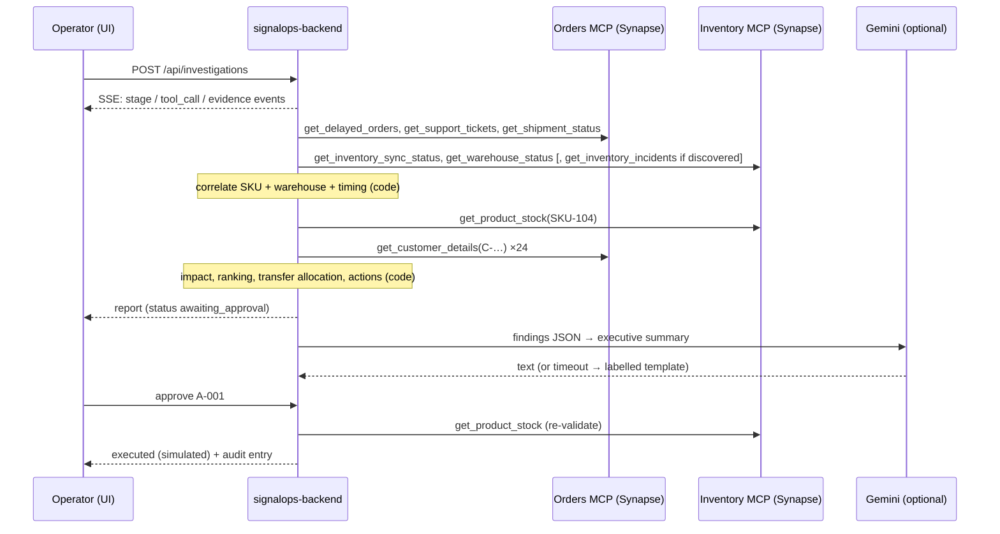

# Architecture

## Principles → where they live
| Principle (plan §1) | Implementation |
|---|---|
| Synapse essential, visible | All business reads go through `mcp_clients/servers.py` (stdio sessions to `synapse-mcp`); Systems page lists tools per server; activity feed tags every call with its server |
| Separate codebases | `nova-orders`, `nova-inventory`: own app, venv, SQLite, seed, tests |
| Evidence for every finding | `agent/orchestrator.py` `add_evidence()`; findings reference evidence IDs; UI links them |
| Deterministic calculations | `agent/correlation.py`, `impact.py`, `prioritization.py` — no LLM |
| Facts vs hypotheses vs unknowns | Finding status `confirmed / likely / hypothesis / unknown` with a written reason |
| Partial, labelled reports | Tool failures → `gaps[]`, status `partial`; tested for each system down, truncation, retries, call budget |
| Human approval | `services/approvals.py`: re-validate via MCP, simulated ledger, one decision per action, audit JSONL |
| Repeatable demo | Deterministic seeds + fixed clock; `scripts/rehearse.py` checks every number |

## Bounds and safety
- Tool calls: budget 60 per investigation, 20 s timeout each, 1 retry (read-only tools only).
- Sessions are opened per request (~2 s with the global `synapse-mcp` install), so `synapse build --discover` changes are picked up without restarting.
- The LLM sees only the finished findings JSON and is instructed not to add facts; its output is labelled with its source.

Contracts: [CONTRACTS.md](CONTRACTS.md). Decisions and their reasons: [DECISIONS.md](DECISIONS.md).
